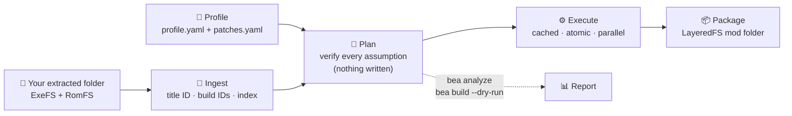

<div align="center">

**English** · [Português (Brasil)](#português-brasil)

# BEA · Backport Engineering Anything

### Give the games you own a second life on the hardware you have.

**Point BEA at a game folder you extracted yourself. It shows you what is inside, shrinks
what is too heavy, applies the tweaks a community profile declares, verifies every byte it
touches, and hands you a ready-to-copy mod folder.**

[](CHANGELOG.md)
[](https://github.com/matheus-aragao-cavalcante/BEA-Backport-Engineering-Anything/actions/workflows/ci.yml)
[](LICENSE)
[](pyproject.toml)

[](#zero-game-content-enforced-by-tests)
[](#why-bea-will-never-open-an-nsp)
[](#not-a-piracy-tool)
[](tests)

[Quick start](#quick-start) · [What it can do](#what-bea-can-do) · [How it works](#how-it-works) · [Why no NSP](#why-bea-will-never-open-an-nsp) · [Profiles](#profiles-recipes-not-copies) · [Roadmap](#project-status-and-pending-work) · [Contributing](#join-the-project)

</div>

> [!IMPORTANT]
> BEA works only on game folders **you have already extracted from games you own**. It does
> not download, decrypt or dump games; it does not read, need or contain console keys; and
> this repository contains no game code, assets, keys or firmware. What BEA produces is
> derived from your copy of the game: it stays with you.

---

## Why BEA?

Games keep getting heavier: 4K textures, 1080p60 cutscenes, settings tuned for the newest
hardware. Plenty of perfectly good hardware is left behind, and the people who own those
games are left with long loading times, stutter, full storage and drained batteries.

**BEA is a free, open-source, game-agnostic pipeline that adapts a game you own to more
modest hardware**, a *backport* in the original sense of the word:

- 🖼️ **Textures** from 1440p/4K down to 720p, losslessly when the file allows it.
- 🎬 **Cutscenes** from 1080p60 down to 720p30, through your own ffmpeg.
- ⚙️ **Settings** files edited declaratively: render scale, shadows, frame-rate caps.
- 🩹 **Executable patches** for resolution and frame rate, applied only to the exact build
  they were written for, and only after every byte they touch has been verified.
- 📦 **A LayeredFS mod folder** at the end: copy it, and your original game stays
  untouched.

The engine knows nothing about any particular game. Everything specific to a game is a
small, human-readable **profile** that the community can write, review and share,
because a profile is a *recipe*, never a copy.

## What BEA can do

| | Capability | In 0.1.0 |
| :-: | :-- | :-- |
| 🔎 | **Inspect** a folder: title ID, every executable module and its build ID, matching profile | ✅ |
| 📊 | **Analyze** without touching anything: inventory by file type, oversized textures, videos, graphics-looking settings, engine guess, the exact plan | ✅ |
| 🖼️ | **Downsize loose textures** (PNG, TGA, DDS): drop mip levels losslessly for *any* pixel format, or resample with Lanczos and friends; power-of-two textures stay power-of-two; alpha handled straight or weighted | ✅ |
| 🎬 | **Transcode videos** (MP4, WebM, MKV, …): downscale and cap the frame rate, keeping container and codec family | ✅ needs ffmpeg |
| ⚙️ | **Edit configuration files** (INI, JSON, any text) while keeping comments, order, encoding and CRLF/LF line endings | ✅ |
| 🩹 | **Patch executables safely**: hunks verified by the SHA-256 of a window of *your* module, all-or-nothing per module, written as IPS / IPS32 | ✅ |
| 📦 | **Package** as LayeredFS (`atmosphere/…` layout) or as a flat mod folder | ✅ |
| ♻️ | **Rebuild only what changed**: cached, atomic, parallel, interruptible, reproducible | ✅ |
| 🧪 | **Generate a synthetic sample game** to try everything without any real game | ✅ |
| 🤖 | **Agent-ready**: `--json` everywhere, an agent skill, a Claude Code plugin manifest | ✅ |
| 🧩 | Textures inside NX texture containers (BNTX), block-linear tiling, ASTC encoding | 🔜 [next](docs/ROADMAP.md#next-asset-formats) |
| 🏗️ | Unity and Unreal Engine containers (what is stored in the clear) | 🔭 [later](docs/ROADMAP.md#later-engine-containers) |

## Quick start

BEA needs Python 3.12 or newer and [uv](https://docs.astral.sh/uv/).

```console
git clone https://github.com/matheus-aragao-cavalcante/BEA-Backport-Engineering-Anything.git
cd BEA-Backport-Engineering-Anything
uv sync
uv run bea doctor
```

### Try it in one minute, without any game

`bea synth` generates a **synthetic sample game**: procedural textures, a made-up
executable with two patch sites, configuration files, and a matching profile. Nothing in
it comes from a real game.

```console
uv run bea synth .gamedump/sample --profiles-dir .gamedump/sample-profiles
uv run bea build .gamedump/sample --profiles-dir .gamedump/sample-profiles --dry-run
uv run bea build .gamedump/sample --profiles-dir .gamedump/sample-profiles
```

```text
Built <TitleID>  ->  out\<TitleID>  (atmosphere layout)
Profile    <TitleID> "BEA Synthetic Sample" in .gamedump\sample-profiles\<TitleID>
  binary    1 done
  config    2 done
  texture   4 done
  assets    8.7 MiB -> 2.5 MiB
  skipped   1 unsupported
Next: copy out\<TitleID>\atmosphere to the root of your SD card.
```

Run it again and every action comes back `cached`. The `unsupported` line is BEA being
honest: one sample texture uses a format it cannot shrink yet, and it says so instead of
pretending.

### Use it on a folder you extracted

BEA expects a folder you already extracted from a game you own, holding an `ExeFS` and/or
a `RomFS` directory. Producing that folder is outside the scope of this project.

```console
uv run bea inspect  .gamedump/MyGame          # title ID, build IDs, is there a profile?
uv run bea analyze  .gamedump/MyGame          # read-only report: backport_report.json
uv run bea build    .gamedump/MyGame --dry-run
uv run bea build    .gamedump/MyGame
```

```text
out/<TitleID>/
├── atmosphere/
│   ├── contents/<TitleID>/romfs/...                 only the files that changed
│   └── exefs_patches/bea-<TitleID>/<BuildID>.ips    verified executable patches
├── bea_build.json                                   every action, every skip, every reason
└── DO_NOT_DISTRIBUTE.txt
```

Without a profile, BEA only downsizes loose textures to the target box (1280x720 by
default, `--max-width` / `--max-height` to change it). With a profile in
`profiles/<TitleID>/`, it also edits settings, transcodes videos and writes the patches
declared for your exact build.

## How it works



1. **Ingest** reads identities from the files themselves: the title ID from `main.npdm`,
   the build ID from each module header, an index of the RomFS. BEA never writes into
   your input folder.
2. **Plan** asks each transformer what it would do and verifies the profile against your
   files: settings keys must exist, patch windows must match. A profile that does not
   fit your version is refused, not guessed at.
3. **Execute** runs each action once; results are cached by content and parameters, and
   written atomically, so an interrupted build simply resumes.
4. **Package** lays out only the changed files. A manifest records what BEA created, so
   a later build can clean up after itself without ever touching your own files.

## Why BEA will never open an NSP

This is the most important design decision of the project, and it is deliberate.

Packaged game files (`.nsp`, `.xci`, and their compressed `.nsz` / `.xcz` forms) are
**encrypted**. Opening one means decrypting it with keys taken from a console. Laws such
as the anti-circumvention provisions of the US DMCA (section 1201) and their equivalents
elsewhere treat tools that decrypt protected content very differently from tools that
work on plain files. In recent years, removal requests have taken down open-source
projects precisely for decrypting packages, sometimes down to the level of a format
library, and a single such request disables a whole repository, with every fork and
every contributor's work in it.

So BEA draws a hard line:

- **The only input is a folder that is already extracted**, made of plain files. BEA
  starts where decryption has already happened, on a copy that you made of a game you
  own.
- **BEA has no code that reads, searches for or uses keys.** A test fails the build if a
  key-file name ever appears in the engine.
- **Packaged dumps are refused** with a clear message. BEA recognizes them only to tell
  you that it will not open them.
- **BEA never explains or links to** how to obtain games, keys or firmware, how to dump a
  game, or how to modify a console. Issues asking for that are closed.
- **BEA never rebuilds installable packages.** That would produce a complete copy of a
  game and require defeating signature checks. LayeredFS already covers your own use.

The result: BEA's whole surface is ordinary file processing (resizing images, editing
text, writing small verified patches), which keeps the project, and the community around
it, on solid ground. The reasoning is recorded in the
[roadmap](docs/ROADMAP.md#deliberately-out-of-scope) so that it is never reopened by
accident.

## Not a piracy tool

BEA is built so that it has nothing to offer to piracy, and its rules are enforced by
code, not only by words:

| Promise | How it is kept |
| :-- | :-- |
| You need your own copy | BEA reads a folder you extracted from a game you own; it downloads nothing and contains nothing. |
| Outputs stay with you | Every package carries a `DO_NOT_DISTRIBUTE.txt`; the docs say "share the profile, not the output". |
| Profiles hold no game bytes | Patch sites are verified by SHA-256 hash windows; a test rejects literal original bytes in any repository profile. |
| No protection is ever defeated | Every patch in this repository must declare a performance category (frame rate, resolution, LOD, …), and a test checks it. There is no category for signature, licence, DRM, online or region checks, and such contributions are refused. |
| No system software is patched | BEA refuses to patch anything that is not an application. |
| Offline by design | No telemetry, no network access, no automatic downloads. |
| Clean-room code | Written from public documentation; no code copied from other projects; synthetic tests only. |

### Zero game content, enforced by tests

`tests/test_arch_rules.py` runs with every test run and fails if the repository ever
contains anything but small text files, if the engine names a game, a title ID, a build
ID or a key file, or if a profile holds code, binaries or original bytes. Every rule is
also run against a planted violation, so no rule can pass by accident.

## Profiles: recipes, not copies

```yaml
# profiles/<TitleID>/profile.yaml
schema: 1
title_id: "0100000000000000"
target: {max_width: 1280, max_height: 720}
textures:
  rules:
    - match: ["ui/**"]                 # first match wins
      max_width: 1920
      max_height: 1080
    - match: ["**/*_lut.*"]
      skip: true
configs:
  - match: "config/graphics.ini"
    format: ini
    edits:
      - {section: "Rendering", key: "ResolutionScale", value: "70"}
```

```yaml
# profiles/<TitleID>/patches.yaml (one entry per build of the executable)
schema: 1
title_id: "0100000000000000"
builds:
  - build_id: "0123456789ABCDEF0123456789ABCDEF01234567"
    patches:
      - name: render-720p
        category: resolution
        hunks:
          - offset: 0x1A2B3C
            patch_bytes: "08 5A 80 52"            # written by the profile's author
            expected_sha256: "<printed by bea nso hunk>"
            window_offset: 0x1A2B30
            window_length: 32
```

A patch is applied only when the build ID of your module matches **and** every
verification window hashes to the expected value; otherwise nothing at all is written for
that module. `bea profile init` starts a profile for your folder, and
`bea nso image` / `bea nso hunk` help you find and describe patch sites. Full reference:
[docs/PROFILES.md](docs/PROFILES.md) · guide: [docs/PROFILE_AUTHORING.md](docs/PROFILE_AUTHORING.md).

### Better together with REA

Finding *where* a game sets its render resolution is reverse-engineering work.
[REA](https://github.com/morluto/rea) connects coding agents to disassemblers; BEA turns
what you find into a verified, shareable recipe. The authoring guide shows the workflow:
`bea nso image` writes a flat memory image for the disassembler, and `bea nso hunk` turns
an address and your replacement bytes into a ready-to-paste hunk.

## Commands

| Command | Purpose |
| :-- | :-- |
| `bea inspect <folder>` | Identify the game: title ID, modules and build IDs, matching profile |
| `bea analyze <folder>` | Read-only inventory and plan summary (`backport_report.json`) |
| `bea build <folder>` | Apply the profile and write the mod folder; `--dry-run` shows the plan |
| `bea profile validate` | Check every profile, or the ones given, and list every problem at once |
| `bea profile init <folder>` | Create a profile skeleton with your IDs filled in |
| `bea nso info / image / hunk` | Look inside an executable module while writing patches |
| `bea synth <dir>` | Generate the synthetic sample game |
| `bea doctor` | Versions, optional tools, profile directory |

Every command has `--help`; the reporting ones have `--json`. Exit codes: `0` success,
`1` finished with problems, `2` could not run, `130` interrupted.

### Use it from a coding agent

```text
/plugin marketplace add matheus-aragao-cavalcante/BEA-Backport-Engineering-Anything
/plugin install bea@bea
```

The skill in [`skills/backport-engineering-anything`](skills/backport-engineering-anything/SKILL.md)
teaches an agent to drive BEA and to write profiles, with the same boundaries as this
README.

## Project status and pending work

**Version 0.1.0**, the first public version. What it contains is listed in the
[changelog](CHANGELOG.md). Still open:

- [ ] Independent review of the format modules (NSO, IPS, DDS, image headers, NACP, NPDM, PFS0).
- [ ] First test on real hardware (layout and IPS offsets are verified on synthetic data only).
- [ ] First community profile: `profiles/` holds only the template, so **yours could be the first**.
- [ ] First CI run on GitHub, then a tagged release and a package on PyPI.
- [ ] More field testing of video transcoding; manifests for more coding agents.
- [ ] A review by a qualified lawyer; the project's policy is engineering research, not legal advice.

Known limitations of 0.1: only loose RomFS files are processed (textures inside engine
containers are listed, not changed); there is no encoder for BC4/BC6H/BC7/ASTC, so those
textures are mip-dropped or reported; executables using the newer zstd-based compression
are refused. Details and the plan ahead: [docs/ROADMAP.md](docs/ROADMAP.md).

## FAQ

<details>
<summary>Do I need console keys?</summary>

No. BEA never decrypts anything and has no code that reads keys. Its only input is a
folder of plain files that you extracted yourself.
</details>

<details>
<summary>Does this repository contain game files?</summary>

No, and its tests enforce it: the repository may contain only small text files, profiles
may contain only YAML and notes, and nothing under `bea/` may name a game. The tests run
on synthetic data generated on the spot.
</details>

<details>
<summary>Why not just read my NSP? It would be so convenient.</summary>

Because opening it means decrypting it, and that is exactly what has taken comparable
projects offline. Keeping BEA to extracted folders keeps it available for everyone. See
[Why BEA will never open an NSP](#why-bea-will-never-open-an-nsp).
</details>

<details>
<summary>Will BEA make my game run at a different resolution or frame rate?</summary>

Only if a profile for your exact build declares how, and only as well as that profile was
tested. BEA verifies that a patch *applies*; it cannot verify that the game *behaves*.
Without a profile, BEA only makes loose textures smaller.
</details>

<details>
<summary>Is my original game modified?</summary>

No. BEA never writes into the input folder. The mod folder it produces is layered on top
of the game at load time, so removing the folder restores the original behaviour.
</details>

<details>
<summary>Can I share what BEA produced?</summary>

Share the profile, not the output. The output contains files derived from your copy of
the game; the profile contains none.
</details>

<details>
<summary>Does BEA upload or download anything?</summary>

No. No telemetry, no network access, no automatic downloads.
</details>

## Join the project

BEA gets better with every profile and every format it learns:

- 📜 **Write a profile** for a game you own: [docs/PROFILE_AUTHORING.md](docs/PROFILE_AUTHORING.md).
- 🧩 **Teach BEA a format** (BNTX, block-linear tiling, archives): start from
  [docs/FORMATS.md](docs/FORMATS.md) and [docs/ARCHITECTURE.md](docs/ARCHITECTURE.md).
- 🔍 **Review a format module** with fresh, adversarial eyes; it is the top item of the roadmap.
- 🐞 **Report a bug** with a synthetic reproducer (`bea synth` helps).

Read [CONTRIBUTING.md](CONTRIBUTING.md) first; the hard rules fit on one screen.
Security problems go to the [private channel](SECURITY.md), never to a public issue.

## Documentation

- [docs/PROFILES.md](docs/PROFILES.md): every key of `profile.yaml` and `patches.yaml`
- [docs/PROFILE_AUTHORING.md](docs/PROFILE_AUTHORING.md): writing and testing a profile
- [docs/ARCHITECTURE.md](docs/ARCHITECTURE.md): how the engine is built and the rules it obeys
- [docs/FORMATS.md](docs/FORMATS.md): the file formats BEA reads and writes, with public sources
- [docs/ROADMAP.md](docs/ROADMAP.md): pending work, what is next, what is deliberately out of scope
- [CHANGELOG.md](CHANGELOG.md): what each version contains
- [AGENTS.md](AGENTS.md) and [CLAUDE.md](CLAUDE.md): map and rules for coding agents

## Disclaimer

BEA is an independent project. It works only on game folders you have already extracted
from games you own; it does not download, decrypt or dump games and does not contain or
handle console keys. Files BEA produces are derived from your copy of the game: keep them
for your own use and do not share them. Whether extracting or modifying games you own is
permitted depends on where you live and on the agreements you accepted; you are
responsible for complying. This is not legal advice. Read [DISCLAIMER.md](DISCLAIMER.md).

Nintendo Switch is a trademark of Nintendo. All other names belong to their owners. BEA
is not affiliated with or endorsed by any of them.

## License

[MIT](LICENSE). Third-party components keep their own licenses; see
[THIRD_PARTY_NOTICES.md](THIRD_PARTY_NOTICES.md).

---

<div align="center">

## Português (Brasil)

*Tradução do texto acima. Em caso de divergência, vale a versão em inglês.*

### Dê uma segunda vida aos jogos que são seus, no hardware que você tem.

**Aponte o BEA para uma pasta de jogo que você mesmo extraiu. Ele mostra o que há dentro,
enxuga o que é pesado demais, aplica os ajustes que um perfil da comunidade declara,
verifica cada byte que toca e entrega uma pasta de mod pronta para copiar.**

</div>

> [!IMPORTANT]
> O BEA só trabalha com pastas de jogo **que você já extraiu de jogos que são seus**. Ele
> não baixa, não descriptografa e não faz dump de jogos; não lê, não precisa e não contém
> chaves de console; e este repositório não contém código, assets, chaves ou firmware de
> nenhum jogo. O que o BEA produz é derivado da sua cópia do jogo: fica com você.

### Por que o BEA?

Os jogos ficam cada vez mais pesados: texturas 4K, cutscenes 1080p60, configurações
pensadas para o hardware mais novo. Muito hardware bom fica para trás, e quem tem esses
jogos convive com carregamentos longos, travadas, armazenamento lotado e bateria no fim.

**O BEA é um pipeline gratuito, de código aberto e agnóstico a jogos que adapta um jogo
seu a um hardware mais modesto**, um *backport* no sentido original da palavra:

- 🖼️ **Texturas** de 1440p/4K para 720p, sem perda quando o arquivo permite.
- 🎬 **Cutscenes** de 1080p60 para 720p30, com o seu próprio ffmpeg.
- ⚙️ **Arquivos de configuração** editados de forma declarativa: escala de renderização,
  sombras, limite de quadros.
- 🩹 **Patches de executável** de resolução e taxa de quadros, aplicados só ao build exato
  para o qual foram escritos, e só depois de verificar cada byte que tocam.
- 📦 **Uma pasta de mod LayeredFS** no final: é só copiar, e o jogo original continua intacto.

O motor não sabe nada sobre nenhum jogo em particular. Tudo o que é específico de um jogo
fica num **perfil** pequeno e legível, que a comunidade pode escrever, revisar e
compartilhar, porque um perfil é uma *receita*, nunca uma cópia.

### O que o BEA faz

| | Recurso | Na 0.1.0 |
| :-: | :-- | :-- |
| 🔎 | **Inspecionar** uma pasta: title ID, cada módulo executável e seu build ID, perfil correspondente | ✅ |
| 📊 | **Analisar** sem tocar em nada: inventário por tipo, texturas grandes demais, vídeos, configurações com cara de gráficos, palpite de engine, o plano exato | ✅ |
| 🖼️ | **Reduzir texturas soltas** (PNG, TGA, DDS): remover níveis de mip sem perda para *qualquer* formato de pixel, ou reamostrar com Lanczos e companhia; potências de dois continuam potências de dois; alfa tratado de forma direta ou ponderada | ✅ |
| 🎬 | **Transcodificar vídeos** (MP4, WebM, MKV, …): reduzir a resolução e limitar a taxa de quadros, mantendo contêiner e família de codec | ✅ precisa do ffmpeg |
| ⚙️ | **Editar arquivos de configuração** (INI, JSON, qualquer texto) mantendo comentários, ordem, codificação e quebras de linha CRLF/LF | ✅ |
| 🩹 | **Aplicar patches em executáveis com segurança**: hunks verificados pelo SHA-256 de uma janela do *seu* módulo, tudo ou nada por módulo, gravados como IPS / IPS32 | ✅ |
| 📦 | **Empacotar** como LayeredFS (layout `atmosphere/…`) ou como pasta de mod plana | ✅ |
| ♻️ | **Refazer só o que mudou**: cache, gravação atômica, paralelismo, retomada, reprodutibilidade | ✅ |
| 🧪 | **Gerar um jogo de exemplo sintético** para experimentar tudo sem nenhum jogo real | ✅ |
| 🤖 | **Pronto para agentes**: `--json` em tudo, um skill para agentes, manifesto de plugin do Claude Code | ✅ |
| 🧩 | Texturas dentro de contêineres de textura NX (BNTX), tiling block-linear, codificação ASTC | 🔜 [próximo](docs/ROADMAP.md#próximo-formatos-de-assets) |
| 🏗️ | Contêineres de Unity e Unreal Engine (o que estiver guardado em claro) | 🔭 [depois](docs/ROADMAP.md#depois-contêineres-de-engine) |

### Início rápido

O BEA precisa de Python 3.12 ou mais novo e do [uv](https://docs.astral.sh/uv/).

```console
git clone https://github.com/matheus-aragao-cavalcante/BEA-Backport-Engineering-Anything.git
cd BEA-Backport-Engineering-Anything
uv sync
uv run bea doctor
```

**Experimente em um minuto, sem nenhum jogo.** O `bea synth` gera um **jogo de exemplo
sintético**: texturas procedurais, um executável inventado com dois pontos de patch,
arquivos de configuração e um perfil correspondente. Nada ali vem de um jogo real.

```console
uv run bea synth .gamedump/sample --profiles-dir .gamedump/sample-profiles
uv run bea build .gamedump/sample --profiles-dir .gamedump/sample-profiles --dry-run
uv run bea build .gamedump/sample --profiles-dir .gamedump/sample-profiles
```

Rode de novo e todas as ações voltam como `cached`. A linha `unsupported` é o BEA sendo
honesto: uma das texturas do exemplo usa um formato que ele ainda não sabe reduzir, e ele
avisa em vez de fingir.

**Use numa pasta que você extraiu.** O BEA espera uma pasta que você já extraiu de um jogo
que é seu, com um diretório `ExeFS` e/ou `RomFS`. Produzir essa pasta está fora do escopo
deste projeto.

```console
uv run bea inspect  .gamedump/MeuJogo         # title ID, build IDs, existe perfil?
uv run bea analyze  .gamedump/MeuJogo         # relatório somente leitura: backport_report.json
uv run bea build    .gamedump/MeuJogo --dry-run
uv run bea build    .gamedump/MeuJogo
```

Sem perfil, o BEA apenas reduz as texturas soltas para a caixa-alvo (1280x720 por padrão;
`--max-width` / `--max-height` mudam isso). Com um perfil em `profiles/<TitleID>/`, ele
também edita configurações, transcodifica vídeos e grava os patches declarados para o seu
build exato.

### Como funciona

1. **Ingest** lê as identidades nos próprios arquivos: o title ID no `main.npdm`, o build
   ID no cabeçalho de cada módulo, um índice do RomFS. O BEA nunca escreve na sua pasta de
   entrada.
2. **Plano** pergunta a cada transformador o que ele faria e confere o perfil contra os
   seus arquivos: as chaves de configuração precisam existir, as janelas de patch precisam
   bater. Um perfil que não serve para a sua versão é recusado, nunca "adivinhado".
3. **Execução** roda cada ação uma vez; os resultados ficam em cache por conteúdo e
   parâmetros e são gravados de forma atômica, então um build interrompido simplesmente
   continua de onde parou.
4. **Empacotamento** organiza só os arquivos alterados. Um manifesto registra o que o BEA
   criou, para que um build seguinte limpe o que for dele sem nunca tocar nos seus arquivos.

### Por que o BEA nunca vai abrir um NSP

Esta é a decisão de projeto mais importante do BEA, e ela é deliberada.

Arquivos de jogo empacotados (`.nsp`, `.xci` e as formas comprimidas `.nsz` / `.xcz`) são
**criptografados**. Abrir um deles significa descriptografá-lo com chaves tiradas de um
console. Leis como as disposições antievasão do DMCA dos EUA (seção 1201) e equivalentes
em outros países tratam ferramentas que descriptografam conteúdo protegido de um jeito
muito diferente de ferramentas que trabalham com arquivos comuns. Nos últimos anos,
pedidos de remoção derrubaram projetos de código aberto justamente por descriptografar
pacotes, às vezes chegando ao nível de uma biblioteca de formatos, e um único pedido
desses desativa um repositório inteiro, com todos os forks e o trabalho de todos os
contribuidores.

Por isso o BEA traça uma linha firme:

- **A única entrada é uma pasta já extraída**, feita de arquivos comuns. O BEA começa onde
  a descriptografia já aconteceu, numa cópia que você fez de um jogo que é seu.
- **O BEA não tem código que leia, procure ou use chaves.** Um teste quebra o build se o
  nome de um arquivo de chaves aparecer no motor.
- **Dumps empacotados são recusados** com uma mensagem clara. O BEA só os reconhece para
  avisar que não vai abri-los.
- **O BEA nunca explica nem aponta** como obter jogos, chaves ou firmware, como fazer dump
  de um jogo ou como modificar um console. Issues pedindo isso são fechadas.
- **O BEA nunca reconstrói pacotes instaláveis.** Isso produziria uma cópia completa de um
  jogo e exigiria burlar verificações de assinatura. O LayeredFS já cobre o seu uso.

O resultado: tudo o que o BEA faz é processamento comum de arquivos (redimensionar
imagens, editar texto, gravar pequenos patches verificados), o que mantém o projeto, e a
comunidade em volta dele, em terreno firme. O raciocínio está registrado no
[roadmap](docs/ROADMAP.md#deliberadamente-fora-do-escopo) para nunca ser reaberto por engano.

### Não é uma ferramenta de pirataria

O BEA foi construído para não ter nada a oferecer à pirataria, e as regras são garantidas
por código, não só por palavras:

| Promessa | Como é cumprida |
| :-- | :-- |
| Você precisa da sua própria cópia | O BEA lê uma pasta que você extraiu de um jogo seu; não baixa nada e não contém nada. |
| As saídas ficam com você | Todo pacote vem com um `DO_NOT_DISTRIBUTE.txt`; a documentação diz "compartilhe o perfil, não a saída". |
| Perfis não guardam bytes do jogo | Os pontos de patch são verificados por janelas de hash SHA-256; um teste rejeita bytes originais literais em qualquer perfil do repositório. |
| Nenhuma proteção é burlada | Todo patch deste repositório precisa declarar uma categoria de desempenho (taxa de quadros, resolução, LOD, …), e um teste confere isso. Não existe categoria para assinatura, licença, DRM, verificação online ou de região, e contribuições assim são recusadas. |
| Nenhum software do sistema recebe patch | O BEA se recusa a aplicar patch em qualquer coisa que não seja um aplicativo. |
| Offline por projeto | Sem telemetria, sem acesso à rede, sem downloads automáticos. |
| Código clean-room | Escrito a partir de documentação pública; nenhum código copiado de outros projetos; só testes sintéticos. |

O `tests/test_arch_rules.py` roda em toda execução dos testes e falha se o repositório
contiver algo além de pequenos arquivos de texto, se o motor citar um jogo, um title ID,
um build ID ou um arquivo de chaves, ou se um perfil tiver código, binários ou bytes
originais. Cada regra também roda contra uma violação plantada, para que nenhuma passe
por acaso.

### Perfis: receitas, não cópias

Um patch só é aplicado quando o build ID do seu módulo bate **e** cada janela de
verificação tem o hash esperado; caso contrário, nada é gravado para aquele módulo. O
`bea profile init` começa um perfil para a sua pasta, e o `bea nso image` / `bea nso hunk`
ajudam a encontrar e descrever pontos de patch. Referência completa:
[docs/PROFILES.md](docs/PROFILES.md) · guia: [docs/PROFILE_AUTHORING.md](docs/PROFILE_AUTHORING.md)
(em inglês; os exemplos de YAML estão na versão em inglês acima).

**Melhor junto com o REA.** Descobrir *onde* um jogo define a resolução de renderização é
trabalho de engenharia reversa. O [REA](https://github.com/morluto/rea) conecta agentes de
código a disassemblers; o BEA transforma o que você encontrar numa receita verificada e
compartilhável. O `bea nso image` grava uma imagem de memória plana para o disassembler, e
o `bea nso hunk` transforma um endereço e os seus bytes de substituição num hunk pronto
para colar.

**Num agente de código:** `/plugin marketplace add matheus-aragao-cavalcante/BEA-Backport-Engineering-Anything`
e depois `/plugin install bea@bea`.

### Situação do projeto e pendências

**Versão 0.1.0**, a primeira versão pública. O conteúdo está no [changelog](CHANGELOG.md).
Ainda em aberto:

- [ ] Revisão independente dos módulos de formato (NSO, IPS, DDS, cabeçalhos de imagem, NACP, NPDM, PFS0).
- [ ] Primeiro teste em hardware real (layout e offsets de IPS só foram verificados com dados sintéticos).
- [ ] Primeiro perfil da comunidade: `profiles/` só tem o template, então **o seu pode ser o primeiro**.
- [ ] Primeira execução da CI no GitHub, depois uma release com tag e um pacote no PyPI.
- [ ] Mais testes em campo da transcodificação de vídeo; manifestos para mais agentes de código.
- [ ] Uma revisão por um advogado qualificado; a política do projeto é pesquisa de engenharia, não aconselhamento jurídico.

Limitações conhecidas da 0.1: só arquivos soltos do RomFS são processados (texturas
dentro de contêineres de engine são listadas, não alteradas); não há codificador para
BC4/BC6H/BC7/ASTC, então essas texturas têm mips removidos ou são relatadas; executáveis
com a compressão mais nova baseada em zstd são recusados. Detalhes e próximos passos:
[docs/ROADMAP.md](docs/ROADMAP.md#português-brasil).

### Perguntas frequentes

- **Preciso de chaves de console?** Não. O BEA nunca descriptografa nada e não tem código
  que leia chaves.
- **Este repositório contém arquivos de jogos?** Não, e os testes garantem isso.
- **Por que não ler meu NSP? Seria tão prático.** Porque abri-lo significa
  descriptografá-lo, e foi exatamente isso que tirou projetos comparáveis do ar. Manter o
  BEA em pastas extraídas o mantém disponível para todo mundo.
- **O BEA vai fazer meu jogo rodar em outra resolução ou taxa de quadros?** Só se um perfil
  para o seu build exato declarar como, e só tão bem quanto esse perfil foi testado. O BEA
  verifica que um patch *se aplica*; não tem como verificar que o jogo *se comporta*.
- **Meu jogo original é modificado?** Não. O BEA nunca escreve na pasta de entrada; a pasta
  de mod é sobreposta ao jogo no carregamento, e removê-la restaura o comportamento original.
- **Posso compartilhar o que o BEA produziu?** Compartilhe o perfil, não a saída.
- **O BEA envia ou baixa alguma coisa?** Não. Sem telemetria, sem rede, sem downloads.

### Participe

- 📜 **Escreva um perfil** para um jogo que é seu: [docs/PROFILE_AUTHORING.md](docs/PROFILE_AUTHORING.md).
- 🧩 **Ensine um formato ao BEA** (BNTX, tiling block-linear, arquivos compactados):
  comece pelo [docs/FORMATS.md](docs/FORMATS.md) e pelo [docs/ARCHITECTURE.md](docs/ARCHITECTURE.md).
- 🔍 **Revise um módulo de formato** com olhos novos e adversariais: é o primeiro item do roadmap.
- 🐞 **Relate um bug** com um reprodutor sintético (o `bea synth` ajuda).

Leia o [CONTRIBUTING.md](CONTRIBUTING.md) primeiro; as regras essenciais cabem numa tela.
Problemas de segurança vão para o [canal privado](SECURITY.md), nunca para uma issue pública.

### Aviso legal

O BEA é um projeto independente. Ele só trabalha com pastas de jogo que você já extraiu de
jogos que são seus; não baixa, não descriptografa e não faz dump de jogos, e não contém
nem manipula chaves de console. Os arquivos que o BEA produz são derivados da sua cópia do
jogo: mantenha-os para uso próprio e não os compartilhe. Se extrair ou modificar jogos que
são seus é permitido depende de onde você mora e dos contratos que você aceitou; cumprir
essas regras é responsabilidade sua. Isto não é aconselhamento jurídico. Leia o
[DISCLAIMER.md](DISCLAIMER.md).

Nintendo Switch é uma marca da Nintendo. Todos os outros nomes pertencem aos seus
respectivos donos. O BEA não é afiliado a nenhum deles nem endossado por eles.

### Licença

[MIT](LICENSE). Componentes de terceiros mantêm as próprias licenças; veja o
[THIRD_PARTY_NOTICES.md](THIRD_PARTY_NOTICES.md).
